# CastMe 架构、职责与端到端流程地图

> 文档类型：当前架构（As-Is）与优化导航（To-Be Compass）
> 基线：`feat/anime-adaptation` 分支，2026-08-14
> 阅读顺序：系统与模块 → 总流程 → 端到端场景 → 路由参考 → Golden 覆盖 → 优化方向

## 0. 系统本质

CastMe 不是传统应用，没有仓库内的常驻服务、数据库或图像生成代码。它是一个声明式 Agent Skill：宿主读取 Markdown 合约，在当前对话中维护决策状态，再通过宿主提供的图像生成或编辑能力调用 GPT Image 2。

因此：

- Module 是一组有明确职责与 Interface 的行为合约。
- 稳定的 Markdown 标题是 Interface 所在的 Seam。
- ChatGPT、Codex 或其他 API 宿主提供真正执行图像能力的 Adapter。
- 只有 `skills/cast-me/` 会作为运行时包安装；仓库其他文件用于说明、治理和验证。

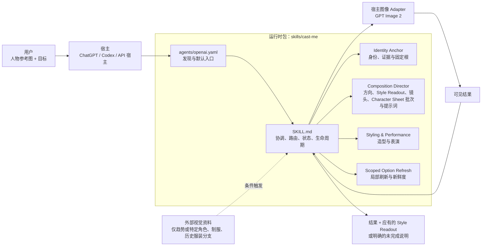

### 仓库层次与信息源职责

| 层次 | 文件 | 职责 | 是否运行时自动读取 |
| --- | --- | --- | --- |
| 安装入口 | `skills/cast-me/agents/openai.yaml` | 展示名、默认提示、隐式调用元数据 | 是 |
| 协调 Module | `skills/cast-me/SKILL.md` | 路由、Choice Gate、决策状态、四阶段生命周期、完成条件 | 是 |
| 所有者 Module | `skills/cast-me/references/*.md` | 身份、构图、造型表演、局部刷新领域知识 | 按需 |
| 用户说明 | `README.md` | 安装、调用和用户示例 | 否 |
| 规范术语 | `CONTEXT.md` | 唯一领域词汇表 | 否 |
| 架构决定 | `docs/adr/*.md` | 已接受的模块边界和取舍 | 否 |
| 规格与研究 | `.scratch/*` | PRD、研究、实施计划 | 否 |
| 行为验证 | `evals/golden-conversations.md` | 可观察行为回归合约 | 否 |
| 贡献约束 | `AGENTS.md`、`docs/agents/*.md` | 修改、Issue、术语与 Triage 规则 | 否 |

运行时、规范术语、ADR、Golden 或 README 相互矛盾时，应把它视为文档或实现漂移并显式修复，不能用简单的文件优先级掩盖冲突。

安装路径只有入口不同：ChatGPT 本地上传 `skills/cast-me` 后通过自动匹配或 `@CastMe` 调用；Codex 安装同一目录后在新会话中用 `$cast-me`。两者进入同一套运行时合约。

## 1. Module、Interface 与职责

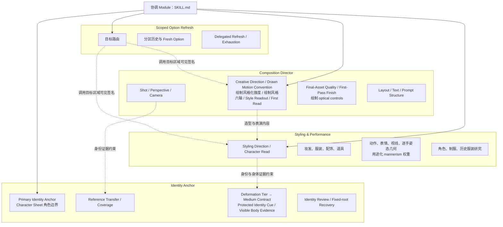

### Module Interface 一览

| Module | Interface 输入 | 拥有 | 明确不拥有 | 输出 |
| --- | --- | --- | --- | --- |
| `SKILL.md` | 用户请求、参考图、对话状态、宿主能力 | 路由、Gate 格式、状态、生命周期、安全异常、完成条件 | 各视觉领域的具体生产知识 | 下一道问题、生产提示词、调用或停止说明 |
| `identity-anchor.md` | 人物图、已锁媒介、显式 Deformation Tier/Custom、目标角度/身体/动作、可见结果 | 身份锚、证据、Drawn Character 分类、Deformation Tier、Medium Contract、Character Sheet 角色、Coverage、Inference Boundary、Identity Review、双手 chirality 检查、假定 mannerism 的审查排除与固定根恢复 | 具体镜头、造型、表演选项 | 变形 Gate、身份约束、媒介通道记录、身体证据梯度、风险 Gate、实际输入与恢复路径 |
| `composition-director.md` | 用途、方向、画布、镜头、成片要求 | First Read、方向、Drawn Motion Convention、绘制风格化强度、绘制风格六轴与具名起点词汇、Style Readout、镜头、透视、成片质量、Character Sheet 保守设计锁、应用表演自由、批次/回退、First-Pass Finish、布局、尺寸、文字与交付、提示词结构 | 妆发服装、表演内容与人物身份 | 构图与成片贡献、Style Readout、输出合约、提示词骨架 |
| `styling-performance.md` | 角色/故事、妆发服装、道具、动作 | Styling Direction、Character Read、Story Makeup、Look Continuity、表演、按 Deformation Tier 与用途加权 mannerism、逐手姿态几何、视觉研究 | 裁切、相机位置、背景空间、身份证据本身 | 造型表演贡献、研究锚点、姿态链 |
| `scoped-option-refresh.md` | 更多、换一批、换某项、你决定 | 刷新目标、最近 Gate、分区历史、新鲜度、委派、耗尽 | 目标区域的具体候选内容 | 新批次、内部选项或重开一个限制锁的 Gate |
| 宿主图像 Adapter | 提示词、实际图像、可用控制 | 执行生成或编辑 | CastMe 领域决策与完成判断 | 图像及可验证的能力、尺寸信息 |

### 刻意不拆出的职责

| 关注点 | 当前归属 | 约束 |
| --- | --- | --- |
| 妆容 | `Styling Direction` | 不增加 Makeup Gate 或独立化妆 Module |
| 润饰和成片 | `First-Pass Finish` | 第一次生成时完成，不建立强制后处理流程 |
| 安全 | `SKILL.md` 异常分支 | 不是普通创意维度 |
| Physical Scene Coherence | Composition 内部检查 | 不是新的用户 Gate |
| Medium Contract | Identity Anchor + 既有非摄影 Output Recipe | closed channel 不作为缺失参考证据请求；不扩展成生产合约，也不增加问题、Gate、Module、流程阶段或运行时组件 |
| Deformation Tier | Identity Anchor + 既有 Choice Gate | A/B/C 语义顺序固定、具体比例按用途适配；身体证据梯度属于该 Tier，后续 Shot 也按已锁 Tier 调整可见 crop 选项；不增加独立身体 Gate、Module 或持久比例档案 |
| 绘制风格化强度 | Composition 的 Creative Direction、First-Pass Finish 与 Prompt + Identity Review | 普通生产决定；独立于 Deformation Tier、渲染 look、surface coloring 和 First-Pass Finish optical controls，不增加固定层级、预设目录、Module 或流程阶段 |
| Drawn Motion Convention | Composition 的 Creative Direction 与 Prompt + Styling 的 Pose Geometry | 只在动作绘制处理影响结果时记录；speed lines、afterimage、repeated limb positions 或 held freeze 是可见词汇，不是固定目录；重复肢体位置必须由用户明确选择，且不改写 Deformation Tier、强度、六轴或摄影 motion treatment |
| 绘制风格六轴与具名起点词汇 | Composition 的 Creative Direction、Output Recipe、Prompt + 既有 Scoped Refresh | line、surface coloring、colour logic、eye rendering、texture、background 分开记录和刷新；First-Pass Finish 负责成片实现，其 optical controls 不并入 surface coloring；不增加 Style Browser、Preset Catalog、Module 或新阶段 |
| Style Readout | Composition 的 `Style Readout` + SKILL 的结果交付 | 从锁定记录披露，不检查图像，也不新增 Gate、轮次或质量裁决；绘制 style state 以六轴 + Tier + 强度为单位，摄影只报告真正改变观感的两三个 Finish controls |
| Character Sheet 与绘制组图 | Identity Anchor 的实际输入/固定根规则 + Composition 的设计、批次/回退、布局与交付 | set、series、reusable design、multi-angle 或同一角色第二张图触发 Sheet（这是连续性条件，不是绘制角色的判定）；可接受用户提供的 Sheet；只有当前操作验证批次能力才走一次批次，否则各项从同一固定根独立生成；不增加 Module、Agent、Gate、批次服务或持久角色库，无连续性要求的单张绘图不使用 |
| 特征表情与 mannerism | Styling 的 Performance Direction + Identity Review | 强变形、熟悉受众的 sticker set 可提高识别权重；静态结构可用或受众不熟悉时保持低权重；单张照片只支持假定，不能推断 Character Read 或新增 profile、Gate、人格模型、审查分数 |
| Identity Review | Identity Anchor | 身份通过与恢复分类由同一所有者判断 |
| Look Continuity | Styling，仅系列任务 | 单张图不创建连续性状态 |
| 质量、尺寸与批次事实 | Composition + 宿主事实 | 不添加质量问卷，不声称不可验证的控制、批次一致性、成功率或可用图数量 |

这些边界对应现有 ADR：身份优先于未确认的故事变换；妆容留在 Styling；风险由 Protected Identity Cue 是否被替换或遮挡触发；Character Read 是创意意图；Story Makeup 必须穿过 Finish；优先加深现有 Styling 和 Identity Module；身份约束通过 Medium Contract 解析，后续 Deformation Tier 能力把 Drawn Character 的解析时点收窄到媒介与显式 Tier/Custom 变形都已锁定之后。Drawn Character 指用户要把这个人画成一个角色，而不是用某个非摄影媒介名画一张一次性的图；Identity Anchor 拥有该分类及其举例清单。只点名 illustration、水墨、剪纸或 CG 等媒介不会把请求变成 Drawn Character，也不打开 Deformation Tier。复用绘制角色使用一个锁定 Character Sheet，没有提供时先从 Anchor 生成，再让应用从 Sheet 与 Anchor 分支。

## 2. 共享决策状态与用户 Interface

所有 Module 共用当前对话中的决策状态。它不是数据库，也不承诺跨会话历史。

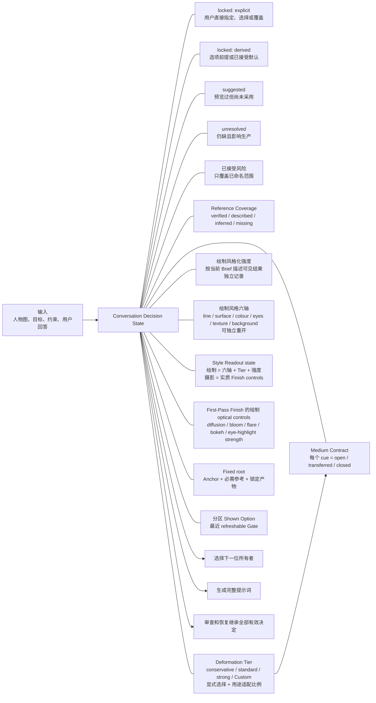

### 状态变化规则

| 当前状态 | 事件 | 新状态 |
| --- | --- | --- |
| `unresolved` | 用户直接指定或选择当前维度 | `locked: explicit` |
| `suggested` | 已选选项把它作为明确前提，或用户接受推荐默认 | `locked: derived` |
| `suggested` / `derived` | 用户重复、细化或覆盖 | `locked: explicit` |
| `derived` | Scoped Refresh 命中其所属区域 | `unresolved` |
| `explicit` | 用户明确重开该字段 | `unresolved` |
| 已锁摄影媒介 | Creative Direction 锁定 | 按既有 photographic default 解析一次请求级 Medium Contract，不需要 Deformation Tier |
| 绘制角色、Deformation Tier 未记录 | 进入下一项普通选择 | 显示 A `conservative` / B `standard` / C `strong` / D Custom 的本地化 Gate；每项给出按用途适配的具体比例与可见后果 |
| 绘制角色已记录 Tier 或具体 Custom 变形 | 当前选择完成 | 解析并记录一次请求级 Medium Contract 与身体证据梯度 |
| 非绘制角色的已锁非摄影媒介 | Creative Direction 锁定 | 从已锁媒介与任何用户显式请求的变形解析，不打开 Deformation Tier |
| 绘制角色、风格化强度仍影响生产且未解决 | 进入当前普通创意选择 | 使用既有本地化 A/B/C/D Gate 展示按当前 Brief 适配的可见结果；不使用固定强度标签或预设目录 |
| 用户只说 `anime`、渲染 look 未解决 | 进入当前 Creative Direction 选择 | 从七项非排他起点词汇中展示三个与 Brief 相关且有六轴可见定义的 A/B/C，加 D Custom；其余方向通过刷新取得，不显示嵌套目录 |
| 用户点名一个风格轴刷新 | Scoped Refresh 命中该轴 | 只重开该轴的 Derived Locks 和用户明确重开的字段；保留其余五轴、First-Pass Finish、强度、Tier 与无关锁 |
| 尚未报告的 style state 产生首个结果 | 交付结果 | 绘制输出报告六轴、Tier 与强度的锁定可见值；摄影输出只报告实质改变观感的两三个 Finish controls；一个 set 只报告一次 |
| style state 组合保持不变 | 后续结果或 set item | 抑制重复 Style Readout |
| 单轴 Scoped Option Refresh 形成新 style state | 刷新后的首个结果 | 只报告移动的同名轴及其新锁定可见值 |
| 已有 Medium Contract | Style / Scoped Refresh 明确重开媒介或 Deformation Tier | 重新解析；只有 closed 集合改变才再次披露 |
| 绘制 set、series、reusable design、multi-angle 或同一角色第二张图 | 生成前 | 使用用户提供且可用的 Character Sheet；否则先从 Anchor 生成并锁定一个；每个应用的固定根都加入 Anchor 与 Sheet |
| Character Sheet 与全部 per-item Brief 已就绪 | P7 宿主能力检查 | 当前操作验证支持完整 set 的一次批次才走该路；否则每项从同一固定根独立生成，不串联应用 |

`locked: explicit` 始终优先于冲突的非显式值。对绘制角色，Medium Contract 读取已锁媒介与用户显式选择的 Deformation Tier 或具体 Custom 变形；`anime`、`chibi`、`manga`、`cartoon`、风格名、Anchor、结果、灯光、构图、遮挡、分辨率和其他场景条件都不参与推断。推荐默认和 `you decide` 不能替绘制角色选档。对其余请求，Medium Contract 只读取已锁媒介与用户显式请求的变形。等比例保留可表达结构 cue 与身体证据，中间比例简化身体证据，次短比例可明确携带胸/腰/臀曲线并披露更成熟观感，最短比例在生成前披露无法携带源图身形。Reference Coverage 在构造记录与路径前读取该 Contract，只按 identity channel 抑制 `closed` 证据请求：最短比例不再追问源图身形，但仍处理可表达的鞋、特征服装、站姿方向与重心位置，其中特征服装随比例关闭而提高 transferred 识别权重。接受某个风险只覆盖已命名的 cue、遮挡、角度、变换、缺失证据或 Medium Contract 关闭的通道，不是全局免责。

绘制角色的风格化强度只描述画面离摄影有多远，不能由 Deformation Tier、渲染 look、surface coloring 或 First-Pass Finish optical controls 推断，也不能反向改写它们。它按普通选择规则显式记录一个具体可见结果；只有仍影响生产且未解决时才显示适配当前 Brief 的既有 Choice Gate。

绘制渲染由 Composition 在同一 Creative Direction owner 内记录六个可见轴：line、surface coloring、colour logic、eye rendering、texture、background。surface coloring 只拥有阴影层数和层间边界；colour logic 另管共享角色色槽、一致性、可区分性和场景整体偏移；screentone 属于 texture；background treatment 不改写角色五轴。First-Pass Finish 仍负责 palette、texture 与 final image character 的生成时实现，但不重新选择已锁六轴；其中绘制 optical controls 包括 diffusion、bloom、flare、bokeh 与 eye-highlight strength，可让 flat cel 分别组合重 diffusion 或零 diffusion。

Flat cel、semi-gradient、thick-painted、watercolour、lineless、monochrome screentone、toon-shaded three-dimensional 只是有可见六轴定义的非排他起点，不是七档 Catalog 或质量排名。艺术家、流派和陌生/不支持的风格词在生产前转换成可见锚点；另一人的 artwork/photo style reference 只供渲染处理，绝不成为人物、年龄或身体身份来源。

Style Readout 随每个未报告 style state 的首个结果交付，不是 Choice Gate、额外轮次或生成过程说明。绘制结果使用与 Scoped Option Refresh 完全相同的六轴名称并写锁定可见值、Tier 和强度；同一 state 的 set 只报告一次，单轴刷新后的新 state 只报告移动轴。摄影结果沿用一次性/差量机制，但只写实质改变观感的两三个锁定 Finish controls，不复制六轴或 Direction Signature。它只读决定记录且永不带艺术家/流派名，也不声称完成、相似、质量或图像符合决定；这些结论仍只由 Identity Review（含 Uneven Stylization）和其他活跃所有者审查产生。

绘制组图在生成前锁定 item 顺序或 panel 组织与一致尺寸。透明 sticker 先说明 GPT Image 2 当前不支持透明背景，只把下游 cutout 记为交付要求；多人绘制请求在生成前停止。实际结果的尺寸、组织和所用批次/回退路径都必须可验证，不承诺 alpha、批次一致性、成功率或可用图数量。

### Choice Gate 合约

每个用户可见 Gate 都使用同一个 Interface：

1. 本地化推荐句和一个简短理由。
2. A/B/C 三个继承完整当前锁、Coverage、已接受风险及已知身份或几何风险，且当前确实可交付的具体方案；只有两个实质方案时，C 表示保持现状并停止。
3. 永久存在的 `D) Custom`，只允许在当前 Gate 范围内自定义。
4. 回复示例同时展示裸推荐项，以及推荐项加本地化 `use recommended defaults`。

D 占位符本身不创建锁或历史；具体 Custom 答案才由当前 Gate 校验。裸字母只解决当前选项拥有的字段。全局 `you decide` 结束普通澄清，但不会绕过 Reference Coverage、身份风险、安全、精确文字或未选择的 Deformation Tier Gate。

Deformation Tier 复用该 Interface，但它不是每次重写的风格菜单：A/B/C 始终按 `conservative`、`standard`、`strong` 的语义顺序出现，显示标签本地化；每项的具体头身比例和圆润度、简化、五官位置、手部与身体曲线后果按用途适配。身体证据取舍写入同一道 Gate，不另问身体形状。后续 Shot Direction 读取已锁 Tier；具体比例无法形成可见不同的 crop 时，内部解析 subject scale，只询问仍有意义的 Shot 字段。

风格化强度也复用该 Interface，但 A/B/C 是当前 Brief 的三个具体可见结果，不是全局固定层级；D 仍是当前范围内的 Custom Path。它属于普通创意决定，可由用户接受默认或委派解决，不增加新阶段。

只说 `anime` 时也复用同一 Interface：一次只显示三个与当前 Brief 相关、由可见六轴定义的起点和 D Custom，不静默选 look，也不嵌套显示全部七项。其他有效起点通过刷新取得；任何 look 或单轴选择都不替代 Deformation Tier 或风格化强度。

八个生产维度只是内部检查顺序，不是八轮问卷：输出类型/画布 → 创意方向 → 镜头/透视 → 造型/妆发/道具 → 画幅/文字 → 表演 → Finish → 避免项。已锁定、无关或已接受默认的维度直接跳过。

## 3. 唯一总流程

后面的九个场景流程都复用这条主干。任何场景都必须能从 P1 走到 P11，或在一个明确阻塞处诚实停止。

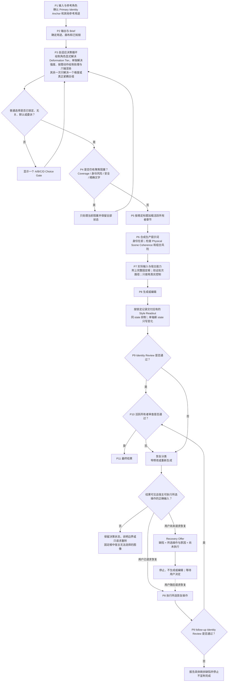

Deformation Tier、Medium Contract、绘制风格化强度、Drawn Motion Convention 和六轴渲染都不增加 P 编号：绘制角色在 P3 通过既有 Choice Gate 显式选择按用途适配的比例，单独记录一个具体强度结果，在动作绘制处理影响结果时记录一个可见 motion convention，并让六轴渲染具体到可见后果。只有用户明确选择 repeated limb positions 才能描绘同一肢体的额外位置。Identity Anchor 随后只用已锁媒介与已记录的 Tier/Custom 解析一次请求级 Medium Contract 和身体证据梯度。在 P6 前，closed channel 与最短比例造成的源图身形损失只做非提问式说明；dense high-frequency texture 的当前模型 artifact 风险按最近复核日期说明，不写成永久缺陷。P6 分开写比例、强度、motion convention、六轴与 First-Pass Finish 的绘制 optical controls，艺术家/流派/陌生风格名不能代替可见锚点；P9 读取同一记录，Character Sheet、应用和重生成都不重新推断。Character Sheet 也不增加 P 编号或新 Module：连续性条件命中时，使用用户提供的 Sheet，或先从 Anchor 生成一个；P7 验证完整 set 的批次能力，能执行才走一次计划批次，否则所有应用从 Anchor + Sheet 独立分支。

Style Readout 同样不增加 P 编号：P8 产生结果后立即按锁定记录决定是否随结果披露，P9 Identity Review 随后独立检查实际图像。readout 的有无和内容都不是 review 证据；即使结果进入 Recovery Offer，它也不能携带完成、相似或质量结论。

### 完成条件

- 所有必需聚焦 Gate 已解决。
- 每张必需人物参考和当前操作需要的锁定产物都作为实际图像输入传入。
- 用户锁定意图没有被静默改变。
- 绘制角色已有用户显式选择的 A/B/C Deformation Tier 或具体 Custom 变形，且整项请求只使用同一份 Medium Contract 与身体证据梯度。
- 绘制角色已有一个具体风格化强度决定，并与 Deformation Tier、渲染 look、surface coloring 和 First-Pass Finish optical controls 分开记录。
- 动作绘制处理影响结果时，已有一个与摄影 motion treatment 分开的 Drawn Motion Convention；repeated limb positions 只有用户明确选择才可用。
- 绘制角色的 line、surface coloring、colour logic、eye rendering、texture 与 background 均有具体可见方向；First-Pass Finish 的绘制 optical controls 与 surface coloring 分开，生产提示词没有用艺术家、流派或陌生标签代替这些方向。
- 另一人的 style reference 只贡献渲染处理；dense high-frequency texture 已显示带复核日期且非永久化的模型 artifact 风险说明。
- 绘制 set 是单人请求，已锁 item 顺序或 panel 组织与一致尺寸；透明 sticker 已说明模型边界并记录下游 cutout。
- 必要的 closed-channel 说明已在生成前显示，且没有进入生产提示词。
- 可见且可检查的结果通过 Identity Review。
- 本次参与生成或修改的所有者贡献都体现在提示词或修改中。
- 交付 set 的实际尺寸与组织已检查；对批次路径、质量、尺寸、文字、工具控制和视觉检查的声称都可验证。
- 当前 style state 应有的 Style Readout 已随结果从锁定记录交付，且没有替代 Identity Review 或其他所有者审查。

## 4. 九个端到端场景流程

| 编号 | 流程族 | 主要区别 |
| --- | --- | --- |
| F1 | 简单头像与人像 | 最短普通路径，不制造故事问题 |
| F2 | 全局默认与委派 | 普通未解决项转为 Derived Locks，聚焦 Gate 仍保留 |
| F3 | Cosplay 与角色妆容迁移 | 真人是唯一身份锚，角色资料只提供造型 |
| F4 | 全身动作与证据缺失 | Coverage 和 Inference Boundary 保留已锁镜头与动作 |
| F5 | Style / Scoped Refresh | 只重开目标区域，维护分区历史和新鲜度 |
| F6 | 精确文字与场景冲突 | 完整允许文字集，一次 Physical Scene Coherence 确认 |
| F7 | 组图、系列与多角度连续性 | Character Sheet 批次/回退 + 每项独立变化；系列另有 Look Continuity |
| F8 | 局部修复与身份漂移 | 先审查，再按结果可靠性和总修改范围选操作 |
| F9 | 安全与宿主能力限制 | 不静默改需求，不声称不可执行或不可检查的动作 |

### F1. 简单头像与人像

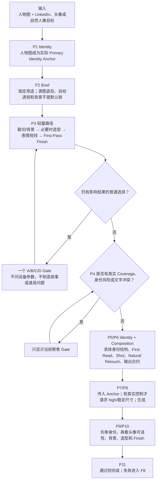

### F2. 全局默认与委派

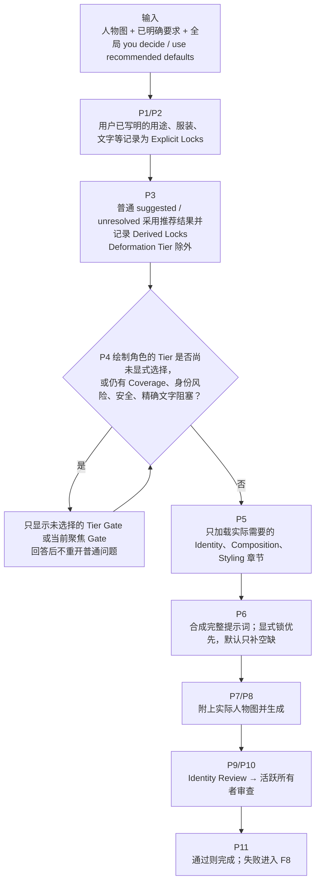

局部刷新中的 `you decide` 只委派已解析出的刷新目标，不等于本流程的全局默认。

### F3. Cosplay 与角色妆容迁移

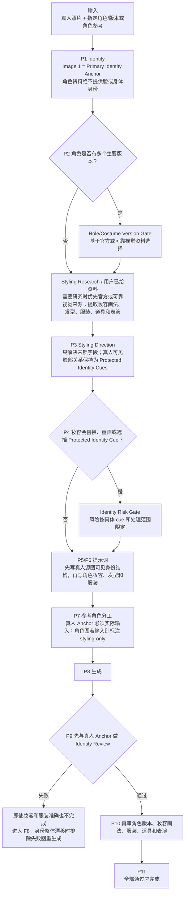

关键不变量：妆容改变颜料、线条、质感、覆盖方式和修饰，不授权放大眼睛、缩鼻、改唇形、改下颌、换肤色或改变年龄感。源图已有妆容但来源未知时，它是 Reference Appearance；只有目标需要的身份 cue 被遮挡才形成 Appearance Coverage 缺口。

### F4. 全身动作与证据缺失

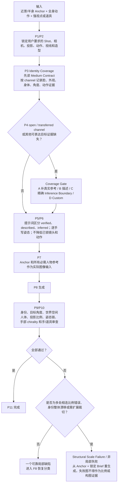

Coverage 抑制按 channel 而不是整块身体区域判断：`closed` channel 不进入缺失证据路径；最短比例不追问无法携带的源图身形，但鞋、特征服装、站姿方向和重心位置仍可触发正常 Gate。Inference Boundary 只允许推断逐项列出的未知区域或事实；它不会把已验证身体证据改成可变项，也不能替代 Primary Identity Anchor。

两手都可见并参与动作时，Pose Geometry 正面写明恰好两只 anatomical hands，并分别给左手和右手的位置、相对身体的朝向与拇指侧；任何简化层级都保留拇指侧，但不取消原有的精细手指 articulation 避免。只有用户明确选择 repeated limb positions 的 Drawn Motion Convention 才可描绘这两只手的额外位置，其他路径不得加手，也不得用换动作、简化手势或安全裁切规避。此时自适应 3–8 条 negatives 才加入两只手锚点不得 duplicated handedness，生成后也检查同一 chirality 条件。

### F5. Style / Scoped Refresh

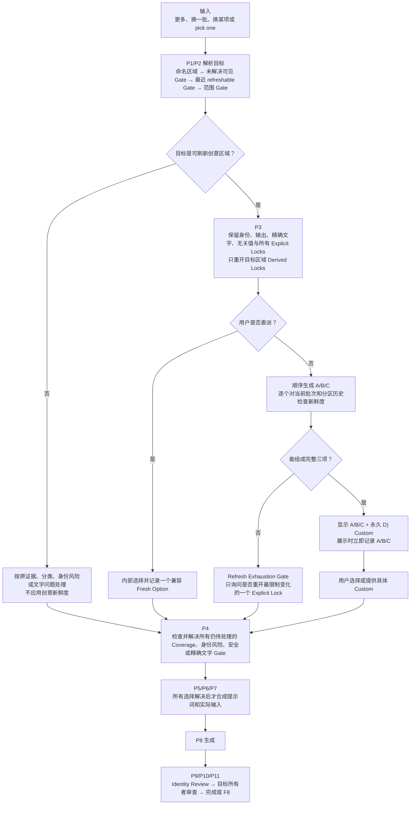

Creative Direction 使用六段 Direction Signature，至少三段不同；其他区域使用所有者可见签名，至少两部分不同。重命名、只换色板、形容词或设备词不算 Fresh Option。询问新选项本身不会生成或修改图片。

只有刷新明确重开媒介或 Deformation Tier/Custom 变形时，Identity Anchor 才重新解析 Medium Contract 与身体证据梯度；Finish、Shot、Styling、Performance、Layout 等其他刷新继续复用原记录。closed 集合未改变时不重复说明。

风格化强度只有在刷新明确指向强度本身时才重开；渲染 look、surface coloring 或 First-Pass Finish optical controls 的刷新继续保留原强度记录。

六轴是 Creative Direction 内部可分别命中的刷新目标。点名 line、surface coloring、colour logic、eye rendering、texture 或 background 时，只重开该轴；特别是 background-only refresh 不改变角色的其余五轴。First-Pass Finish 仍是独立刷新目标，其绘制 optical controls 不改变 shading-layer count 或 boundary treatment，也不重选 Texture 轴。

刷新产生结果时读取新的 style state：单轴 Scoped Option Refresh 只随首个刷新结果返回移动轴及其新锁定可见值；其他多项变化形成的新 state 返回完整 readout。未改变 state 的结果不重复披露。

### F6. 精确文字与场景冲突

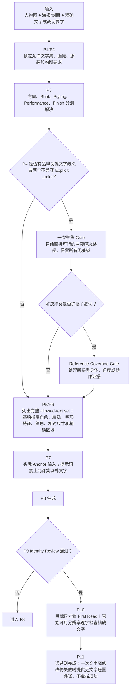

普通缺失字体和排版由方向、布局、First Read、色彩和显示尺寸内部推导，不建立常规 Typography Gate。

### F7. 组图、系列与多角度连续性

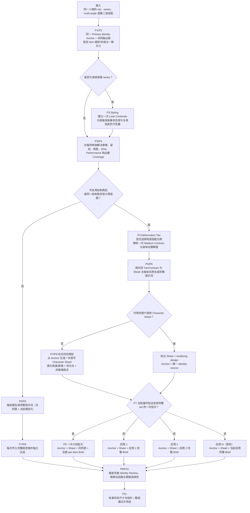

绘制 set、series、reusable character design、multi-angle sheet 或同一角色第二张图需要一个 Character Sheet；无连续性要求的单张绘图直接生成。用户提供的 Sheet 作为同一个已标注 rendering-design 输入使用，不替代人物照片：Anchor 始终是唯一身份来源。没有提供时，Sheet 在干净背景上保留 Anchor 的头部角度与表情，使用均匀光和非极端视点，以最少展示变量锁定已选择的 Deformation Tier/Custom 比例、脸部构造、头发、眼睛画法、服装、palette/colour logic、line treatment、surface coloring/shading treatment 与 texture；这些保守约束只属于 Sheet，干净背景也不锁定应用的 background 轴。

只有当前操作实际验证支持完整 set 的一次批次时，才把全部 per-item Brief 与共同锁放入一个计划批次；否则每项从同一 Anchor + Sheet 固定根独立生成。两条路径都禁止应用互作输入，复用同一 Medium Contract、palette 和设计锁，并保留每项自己的场景、表情、视线、姿态/动作、脸部角度、相机角度、灯光、故事状态和输出锁。交付前检查实际尺寸、item 顺序或 panel 组织，并如实说明所走路径；不声称 paid-mode、批次一致性、成功率或可用图数量。计划批次后单独重生成的恢复项不属于原批次，与通过项的一致性只按尽力而为说明，绝不声称批次一致性。

同一绘制 style state 的整组结果只携带一份 Style Readout，不按 item 重复；每项的表演、镜头或故事状态变化不会自行创建新的 style state。

强变形 sticker set 在静态结构通道减少且目标受众熟悉本人时，可以提高有用的特征表情或 mannerism 的识别权重；social avatar、等比例绘制人像、静态结构仍可用或受众可能不熟悉本人时保持低权重。单张照片中的表情、视线、姿态或手位只能记为假定，不能推出习惯、Character Read、人格、职业、关系或内在特质；其缺失、变化或执行不完美也不能让 Identity Review 失败，审查仍只读请求级 Medium Contract 的 open / transferred 通道和既有缩略图 silhouette 下限。

透明 sticker 在生成前说明 GPT Image 2 当前不支持透明背景，并只记录下游 cutout 要求；不承诺 alpha 或自动 cutout。多人绘制请求在生成前停止，避免混合身份。单张图片也不创建 Look Continuity。

### F8. 局部修复、身份漂移与重生成

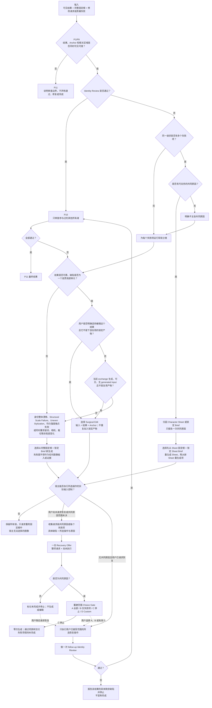

Identity Review 先读取生成前记录的 Medium Contract，再判断是否完成并决定恢复范围。它只审 open 与 transferred 通道：任一 structural cue 仍 open 时，recognizability 不能替代逐 cue 审查；没有 structural cue open 时，transferred cues 的识别性决定完成，并额外要求缩略图尺寸的 filled silhouette 可辨。closed cue 的缺席本身不是失败或恢复理由。妆容、服装或场景做得漂亮不代表身份通过；“用户说不像”也不会自动证明它只是局部缺陷。每个可见、可查且明确失败的结果都先完成恢复分类；若用户尚未请求恢复且宿主能执行所选操作，就交付 Recovery Offer，说明具体缺陷、所选操作与原因、尚未执行，并标记未完成后停止。普通单项或无共同原因的 Recovery Offer 不是 Choice Gate；只有共同原因分支继续进入下述范围 Gate。只有用户请求恢复且范围已明确后才执行，再做一次 follow-up Identity Review；仍失败就报告具体剩余缺陷并停止，不宣称完成。同一请求有多个失败项且无法支持共同原因时，先把每项分类到所选操作，再收进一份请求级 Recovery Offer；明确不主张共同原因，每项分别写具体缺陷与操作，一条用户指令可以接受全部、点名子集或全部不接受，不逐项追问，也不要求重述请求。

一套图中多张出现同一缺陷时，仍归因为 Character Sheet 或锁定 Brief 失败——每次重生成都会继承它——并只报告一次共同原因。该原因选择先从 Sheet 自己的完整固定根和锁定 Sheet Brief 重生成 Sheet，再从新 Sheet 重生成项；Offer 明说两步都尚未执行。新 Sheet 不是旧 Sheet 的补丁，保留旧 Sheet 所生成的项不会再共享新 Sheet 的锁。因此这里只显示一个无默认推荐的本地化 A/B/C/D Choice Gate，并用当前请求的实际数量写成本：A 为一张新 Sheet 加全部项，B 为一张新 Sheet 加失败项且接受同一套图存在两个角色版本，C 为零次生成并原样交付通过项，D 只允许用户在本次重建范围内点名其他子集并在执行前写出一张 Sheet 加所选项的成本。四条路径都不重开创意选择、已解析 Medium Contract 或无关 Explicit Locks，不恢复自动修复，Custom 也不能绕过安全。

绘制角色还读取单独记录的风格化强度，并在两个均匀端点失败：整张图只是加了绘制滤镜的照片，或整张图已经绘制化却以通用动漫脸替换 Anchor 与 Medium Contract 的 open / transferred 通道。两者都是所选强度或执行失败，修正时保留 Deformation Tier 与渲染 look；增加强度只指导下一个可见增量，不写成一步最大化。它们都不是 Uneven Stylization。

固定根由 Primary Identity Anchor、必需可靠人物参考和每张图都复用的锁定产物组成，修正时不随失败结果增长。Character Sheet 是应用固定根中的锁定产物；失败应用必须从 Anchor + Sheet + 完整应用 Brief 重生成，失败 Sheet 必须从它自己的固定根 + Sheet Brief 重生成，两者都排除失败图。用户明确坚持局部编辑某个应用时，先建议重生成，但仍允许只以该应用 + Anchor 直接编辑，不再次加入 Sheet；复用的 Sheet 本身始终不可编辑。

Uneven Stylization 只指部分表面已转换、部分仍摄影化的混合状态；即使人物仍可识别且身份通道无漂移也让 Identity Review 失败，并且从不走 Surgical Edit。宿主能力允许时，Recovery Offer 选择从完整固定根和完整锁定 Brief 新生成；用户请求恢复后，该生成同时处理它与可能并存的身份漂移。固定根包含 Anchor、必需且可靠的支持人物参考，以及请求中每张图都复用的 Character Sheet 等锁定产物，失败图不进入任何图像输入或身份、脸、姿态、身体、构图等证据角色。Composition 的非摄影配方为皮肤、头发、眼睛、服装、灯光和背景逐项正面重述所选媒介，不描述失败图哪些表面仍是摄影处理，也不用负面指令表达其消失。

F8 是主流程的窄修改例外：已有可见结果时直接从 P9 审查开始，不重新走普通创意澄清；只有需要全新生成时才复用锁定 Brief 和正确实际输入回到生成步骤。

### F9. 安全与宿主能力限制

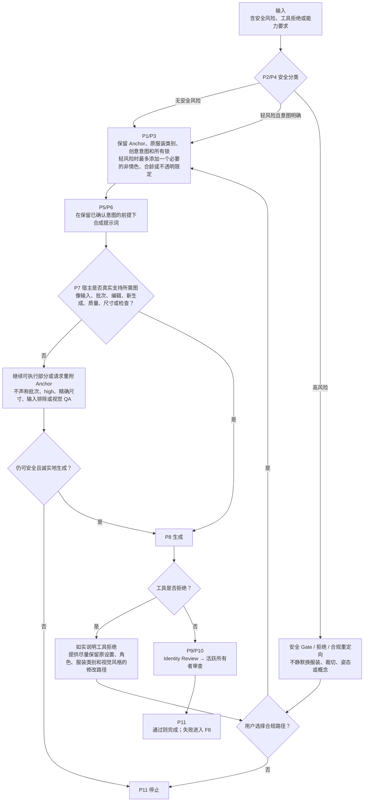

安全处理保持工具无关；能力处理保持事实优先。提示词中的 batch、transparent、4K、high quality 或“保留 Anchor”不能替代真实控制。

## 5. 按需读取与所有者路由参考

协调 Module 通过稳定标题只读取当前活跃章节；宿主不支持分段读取时，整文件读取是正确性后备。分段读取不是正确性依赖，也不维护额外 read-state tracker。

| 活跃条件 | 必读章节 | 条件追加 |
| --- | --- | --- |
| 普通人物图生成 | Identity：`Priority`、`Reference Transfer`、`Reference Coverage` | 无 |
| 绘制角色、变形/强度、动作绘制处理、渲染 look、风格轴/名称或 style reference | Identity：`Reference Transfer`、`Deformation Tier`、`Identity Prompt Constraints`；Composition：`Creative Direction`、`Drawn Motion Convention`、`Drawn Style Axes`、`Drawn Style Starting Vocabulary`、`First-Pass Finish`、`Illustration or Other Non-Photographic Output` | 绘制角色先显式选择 Tier/Custom，单独解决强度，动作处理影响结果时再单独解决 motion convention，并把渲染写成六轴可见锚点；一帧插画不因媒介名打开这些门；First-Pass Finish 实现已锁 palette/texture，而绘制 optical controls 不并入 surface coloring；另一人的 style reference 只供渲染处理；Composition 不重新解析 Medium Contract |
| 绘制 set、series、reusable design、multi-angle、同一角色第二张图或用户提供 Sheet | Identity：`Character Sheet`；Composition：`Character Sheet Applications`、`Layout and Output Contract` | 使用提供的 Sheet，否则先生成一个；应用实际输入都标注 Anchor 与 Sheet；验证批次能力，否则各项独立；检查尺寸、组织与交付边界 |
| 写最终提示词前 | Identity：`Identity Prompt Constraints`；Composition：`Final-Asset Quality`、`First-Pass Finish`、`Prompt Structure` | 所有当前活跃所有者章节 |
| 创意方向、First Read、决定性时刻 | Composition：`Creative Direction`、`Directorial Intent and Decisive Moment` | 需要选项时加 `Direction Atlas and Freshness`；刷新时加 `Style Refresh` |
| 镜头、透视、相机、投影 | Composition：`Shot Direction` | 按需加 `Perspective Intent`、`Camera and Capture Plan`；侧脸/动作/强透视加身份与姿态章节 |
| 物理世界、品味、媒介配方 | Composition 对应的 `Art Direction and Physical World`、`Taste Rules`、`Prompt Craft Rules` 或 `Output Recipes` 子节 | 只读相关媒介 |
| 服装、头饰、首饰、配件、妆发、道具 | Styling 对应的 `Ownership`、`Risk and Facial Treatment`、`Category Routing`、`Styling Direction` 或 `Props` | 按实际字段选择 |
| 故事造型、Delegated Styling、Story Makeup、Look Continuity | Styling：`Ownership`、`Risk and Facial Treatment`、`Styling Direction`、`Prompt Contributions` | 源造型遮挡关键身份 cue 时加 Identity `Reference Coverage` |
| 姿态、动作、表情、视线、手部、表演或 characteristic mannerism | Styling：`Performance Direction`；非简单动作加 `Pose Geometry` | 按 Tier 与用途决定 mannerism 权重；单图推断只是假定；Drawn Character 的动作绘制处理影响结果时加 Composition `Drawn Motion Convention`；脸角度影响身份时加 Identity `Face Visibility and Performance Integrity` |
| 指定角色、制服、历史服装 | Styling：`Role, Costume, and Visual Research` | 多版本时先走版本 Gate |
| 精确文字、布局、交付、变体、透明、set、series 或 multi-angle | Composition：`Layout and Output Contract` | 文字或分区复杂时加 `Prompt Craft Rules` |
| 展示或替换可刷新 Gate | Refresh：`Scope`、`Visible Gate and History` | 按分支加 `Route the Target`、`Locks and Continuity`、`Refresh Exhaustion`，并加载目标所有者 |
| 交付可见结果或 set | Composition：`Style Readout` | 从锁定 style state 决定完整、差量或抑制；与 Identity Review 分开加载 |
| 审查可见结果 | 先 Identity：`Identity Review and Revision` | 再只读实际参与生成或修改的所有者审查段落 |
| 对可见结果做窄修改 | Identity：`Identity Review and Revision` + 修改项所有者 | 涉及脸时加 `Priority`、`Identity Prompt Constraints`；只在真正触及时补其他核心章节 |

### 提示词合成顺序

1. 用途、画布、布局。
2. Primary Identity Anchor、源图可见身份结构、Reference Transfer、Coverage，以及显式 Deformation Tier/Custom 所解析的 open / transferred 通道和可表达身体证据；比例、圆润度、简化、五官位置、手部与身体曲线都用正面绘制语言；应用或批次随后标注 Character Sheet 的绘制设计角色，Anchor 仍是唯一身份来源；另一人的 artwork/photo style reference 只标注渲染用途，绝不当人物、年龄或身体身份；closed-channel 与身形损失说明不进入提示词。
3. 单独记录的绘制风格化强度；动作绘制处理影响结果时再单独写 Drawn Motion Convention；随后用可见语言写 line、surface coloring、colour logic、eye rendering、texture、background，再写其他已锁意图、First Read、创意方向和决定性时刻。已选择的具名 look 只按普通锁规则提供其选项明示的六轴起点，不改写 Tier、强度、motion convention 或未明示的轴；艺术家/流派/陌生词不进入生产提示词。
4. Shot、相机/透视、世界空间人体与投影比例。
5. Styling、Performance、Props、Pose Geometry；只写画面内相关节点，两手可见并参与动作时分别写左/右手位置、相对身体朝向和拇指侧；只有 Tier 与用途需要时才提高假定 mannerism 的识别权重。
6. 有动机的灯光/色彩与 First-Pass Finish；对绘制输出，它实现已锁 palette/texture，而 diffusion、bloom、flare、bokeh、eye-highlight strength 等 optical controls 不改写 surface coloring 或 Texture 轴。
7. 精确文字允许集、平台和交付约束；组图写明 item 顺序或 panel 组织、一致尺寸、批次/回退路径与必要的下游 cutout。
8. 约 3–8 个本次最可能发生且可观察的失败约束；只有两手都可见并参与动作时才选择 duplicated handedness。

禁止用固定高质量后缀、万能负面词表、空字段或紧凑配置块代替完整生产提示词。

### 外部研究、质量与能力

| 条件 | 行为 |
| --- | --- |
| 普通换一批 | 使用当前对话历史与 Direction Atlas，不浏览 |
| 明确 current / latest / trending | Trend Refresh，必须实时研究；无法验证就明说 |
| 指定角色、制服、历史服装 | 优先官方或可靠视觉资料，只提取生产锚点 |
| 艺术家、流派、陌生或不支持的风格词 | 生产前转换为六轴与 First-Pass Finish optical controls 的可见锚点；无法可靠定义时显示三个可见起点 + D Custom，不把名称传入提示词 |
| dense high-frequency micro-structure | 生成前显示当前模型 artifact 风险；仓库当前复核点为 2026-08-12、当时未找到官方修复宣布，必须写成时点信息而非永久缺陷或质量排名 |
| 正常人物成片 | 按 final asset 处理，不加质量问卷 |
| 有真实质量控制 | 请求 `high` |
| 有真实尺寸控制 | 请求不超过 `3,686,400` 总像素且符合画幅的最高稳定尺寸 |
| 用户要求更高尺寸 | 视为实验尺寸；控制可用时简短警告后继续 |
| 控制不存在 | 继续可执行部分，但不声称已设置 high、2K、4K 等 |
| 需要精确尺寸 | 实际检查输出像素后才能声称 |
| 绘制 set / multi-angle | 当前操作验证完整 set 的一次批次能力才走批次；否则各项从同一 Anchor + Sheet 固定根独立生成；说明实际路径，不承诺一致性、成功率或可用图数量 |
| 透明 sticker | 生成前说明 GPT Image 2 当前不支持透明背景；只记录下游 cutout，不承诺 alpha 或自动处理 |
| 组图交付 | 检查每项实际尺寸和 item/panel 组织；不匹配就不声称完成 |
| 结果不可见或分辨率不足 | 对相应审查标记 unavailable / unverified |

## 6. Golden 1–158 覆盖矩阵

每个编号在下表恰好出现一次，表示它的主要端到端流程族；Shared Checks 仍横跨全部流程。场景可以触及多个 Module，但不需要复制多张完整图。

| Golden 编号 | 主流程 | 覆盖主题 |
| --- | --- | --- |
| 1 | F1 | 模糊专业头像 |
| 2 | F2 | 显式全局委派 |
| 3-4 | F1 | 引导式人像、已有部分锁 |
| 5 | F4 | 高风险近景到全身动作 |
| 6 | F6 | 精确文字海报 |
| 7 | F7 | 系列连续性 |
| 8 | F8 | 手部窄修改 |
| 9-11 | F4 | 目标角度身份、透视选择、动作姿态链 |
| 12 | F8 | 保留强投影的协调修复 |
| 13-22 | F5 | Style Refresh、历史、Custom、锁来源、趋势、委派与耗尽 |
| 23-29 | F1 | First-Pass Finish 默认、选择、媒介适配与窄修改 |
| 30-46 | F5 | Finish/Scoped Refresh、目标优先级、分区历史、委派、耗尽与分类边界 |
| 47-49 | F1 | 全身/跨媒介成片质量与预览例外 |
| 50 | F9 | 宿主无质量或尺寸控制 |
| 51-58 | F1 | 实验尺寸、First Read、输出配方和短约束 |
| 59 | F5 | 历史不可用时不承诺精确去重 |
| 60 | F4 | 可访问身份图仍必须作为实际输入 |
| 61 | F9 | 必需身份图对工具不可用 |
| 62-63 | F4 | 多参考角色分工、Inference 不替代身份图 |
| 64-66 | F1 | 实验尺寸面积、警告与实际尺寸检查 |
| 67-68 | F8 | 双尺度审查、强角度自然不对称 |
| 69-70 | F9 | 证据不可用限制声称、质量和尺寸控制独立 |
| 71-76 | F6 | 多条精确文字、品牌排版、显式锁冲突与恢复 |
| 77-92 | F3 | Reference Appearance、造型委派、妆容风险、Story Makeup 与物理一致性 |
| 93-94 | F7 | 系列 Look Continuity 与单图不创建连续性 |
| 95 | F1 | 身份可读但不必成为 First Read |
| 96-97 | F8 | 可见 cue 漂移与造型导致的窄恢复 |
| 98 | F4 | 近景扩展全身的比例恢复 |
| 99 | F3 | 厚重服装仍保留可见上身证据 |
| 100-103 | F4 | 累积风险、充分证据、组合 Coverage 与组合 cue 变换 |
| 104-105 | F9 | Anchor 不可用、宿主受限时不伪装重生成 |
| 106 | F3 | 跨类型参考角色保持通用 |
| 107-108 | F8 | 用户明确请求的局部/整体身份恢复 |
| 109 | F8 | 用户接受 Recovery Offer 后才执行恢复；复审通过才完成，仍失败就具体报告并停止 |
| 110 | F8 | 通过或不可查结果不伪装完成；失败结果的 Recovery Offer 不得退化成完成后的可选美容微调 |
| 111-112 | F8 | 风险范围与尽力而为 |
| 113-115 | F3 | 源图身份细节优先、角色不供脸、妆容形容词不改结构 |
| 116-117 | F6 | 裁切与服装锁冲突、扩裁触发新 Coverage |
| 118 | F8 | 干净呈现不能替代 Identity Review；明确失败只交付 Recovery Offer 或走重附边界 |
| 119 | F2 | 普通 Gate 的全局默认捷径 |
| 120 | F3 | 可靠来源解决角色版本 |
| 121 | F8 | Cosplay 执行干净也不能掩盖身份整体漂移；宿主可执行时给 Recovery Offer，否则只请求重附 Anchor |
| 122 | F5 | Medium Contract 请求级记录、closed-channel 披露与刷新边界 |
| 123-124 | F1 | 请求变形与年龄解释测试、媒介表面处理 |
| 125-126 | F8 | structural-open 边界、transferred 识别与缩略图 silhouette 下限 |
| 127 | F8 | Uneven Stylization 独立失败；先给 Recovery Offer，用户接受后才从完整固定根重生成 |
| 128-130 | F8 | 固定根重生成、generated input 新鲜度与复用产物 |
| 131 | F8 | 未知 provenance 的 Recovery Offer 选择固定根重生成，用户接受后执行且不引入计数 |
| 132 | F7 | 多轮修改和系列图片不增长 generated-input chain |
| 133-136 | F8 | 清理建议与用户接受 Recovery Offer 后沿完整固定根重生成 |
| 137 | F7 | 一个 Character Sheet 锚定两个独立且不同的应用 |
| 138 | F8 | 应用与 Character Sheet 先给 Recovery Offer、用户接受后按各自固定根恢复；显式局部编辑与宿主重附边界不变；同缺陷只报告共同原因并以 Sheet 后项的操作进入四路径范围 Gate |
| 139 | F1 | Deformation Tier 在不同用途保持稳定语义顺序并适配具体比例；manga/cartoon 同样开门且只有用户直选进合约 |
| 140 | F7 | Tier 解析一次身份通道与完整身体证据梯度，并由 Sheet 与应用复用 |
| 141 | F9 | 年轻观感、成熟曲线说明与 child-reading / adult-emphasis 冲突解析；中性承载不算强调 |
| 142 | F8 | 风格化强度独立决定、两个均匀失败端点及与 Uneven Stylization 的边界 |
| 143 | F5 | 六个可见风格轴分别表达和刷新；uniform line 读作硬、strongly varied 读作软；background-only 变更不改角色渲染 |
| 144 | F1 | `anime` 请求得到三个可见特征起点 + Custom；选中 look 只锁选项写明的轴 |
| 145 | F1 | surface coloring、colour logic 与 First-Pass Finish optical controls 正交；full-frame light diffusion 是现代标记；period palette 只限角色层 |
| 146 | F3 | 风格名转换、style-reference 身份边界与带日期的模型 artifact 风险说明 |
| 147 | F7 | 验证一次批次能力，否则从同一 Character Sheet 固定根独立生成，不虚报批次一致性 |
| 148 | F7 | Character Sheet 按连续性需求触发；接受用户提供的 Sheet；外来 Sheet 失败时从 Anchor 与当前 brief 替换 |
| 149 | F9 | 组图尺寸/组织、透明 cutout、尽力而为与多人绘制停止边界 |
| 150 | F7 | Character Sheet 保守锁定源头呈现，但不约束应用的表情、动作、角度与灯光 |
| 151 | F7 | mannerism 按变形与用途加权，单图只是假定且不进入 Identity Review 失败条件 |
| 152 | F8 | 普通 Identity Review 不判定 noise / dirtiness / degradation；局部失败给 Recovery Offer 且不展示计数或剩余次数 |
| 153 | F8 | 无连续性的单张绘制图仍可走 surgical 修复 |
| 154 | F8 | 无共同原因的批次失败逐项选择操作、只报告一次，并由一条指令接受全部、子集或不恢复 |
| 155 | F4 | 已锁 Deformation Tier 抑制 closed 身形证据与不可区分 crop，同时保留鞋、特征服装、站姿和重心 Coverage |
| 156 | F1 | 所有 A/B/C 路径继承当前锁且可交付；不可达路径不显示，Custom 与双解 stop path 不变 |
| 157 | F4 | 强变形双手动作逐手写位置、相对朝向和拇指侧；条件式 chirality 约束与审查；只有明确选择 repeated limbs 才可增加描绘位置 |
| 158 | F5 | 每个 style state 的首个结果携带锁定 Style Readout；set 只报告一次；单轴刷新只报告变化；摄影只写实质 Finish controls；不替代 Identity Review |

当前编号场景没有单独覆盖安全 Gate 或生成工具安全拒绝；F9 的安全分支来自运行时合约和 Shared Checks。只有后续安全行为发生变更时，才增加最小专门 Golden 场景。

## 7. 维护、验证与优化方向

### 变更影响矩阵

| 变更类型 | 首要所有者 | 还要检查 |
| --- | --- | --- |
| 触发、Gate、状态、生命周期 | `SKILL.md` | 所有参考路由、对应 Golden |
| 身份证据、Coverage、审查、恢复 | `identity-anchor.md` | SKILL 路由、Styling/Composition 依赖、Context、Golden |
| 方向、镜头、Finish、布局、提示词 | `composition-director.md` | Identity/Styling Interface、Golden |
| 妆发服装、道具、表演、角色研究 | `styling-performance.md` | Identity 风险、Composition Shot、Golden |
| 刷新、历史、新鲜度 | `scoped-option-refresh.md` | 目标所有者可见签名、Golden |
| 规范术语或架构决定 | `CONTEXT.md` / `docs/adr/` | 全部运行时使用处、本文档、Golden |
| 安装、调用、示例 | `README.md` / `openai.yaml` | 当前宿主真实能力 |

### 当前规模基线

| 资产 | 当前规模 |
| --- | ---: |
| `SKILL.md` | 4,755 词 |
| `composition-director.md` | 8,906 词 |
| `identity-anchor.md` | 7,377 词 |
| `styling-performance.md` | 3,082 词 |
| `scoped-option-refresh.md` | 863 词 |
| 运行时 Markdown 合计 | 24,983 词 |
| `CONTEXT.md` | 43 个规范术语，2,224 词 |
| `docs/adr/` | 11 条 ADR |
| `golden-conversations.md` | 158 个场景，20,260 词 |

### 优化优先级

1. **先守住唯一所有者**：术语在 Context，行为在所有者，协调 Module 只路由，Golden 只描述可观察结果。
2. **保持稳定标题 Seam**：章节改名时同步路由和 Golden；整文件读取继续作为后备。
3. **先测再压缩**：只有实际上下文成本或遗漏证据出现时，才压缩重复合约；不能删除安全、身份、文字和交付边界。
4. **先静态检查再建评测框架**：人工审查开始漏项时，先检查场景编号、Input/Expected、标题引用和确定性 Gate 结构。
5. **优先加深现有 Module**：只有两个子域持续独立变化且发生真实所有权冲突时，才新增 Seam。
6. **宿主差异按事实处理**：出现第二个具体宿主行为且规则真正分叉时，再定义显式 Adapter 合约。

没有真实失败证据时，不增加独立 Makeup Module、强制后处理、持久化选项历史、read-state tracker、普通刷新联网、质量问卷、固定风格目录、身份分数、无限重试或只有一个实现的抽象 Adapter。

### 架构变更完成定义

- 能指出唯一首要所有者，并说明其他 Module 只是依赖还是共同拥有。
- 没有新增与 `CONTEXT.md` 竞争的同义词，也没有静默违反 ADR。
- `SKILL.md` 路由仍指向真实稳定标题。
- Explicit、Derived、Suggested、Unresolved 状态语义没有被绕过。
- 普通 Gate、聚焦 Gate、Scoped Refresh 和恢复路径没有相互吞并。
- 新行为能落到总流程 P1–P11 和一个流程族中。
- Golden 覆盖表仍无遗漏、无重复，新增或改变行为有对应可观察场景。
- 结构校验、Golden 审计与 `git diff --check` 通过。
- 本文档相应图、职责、规模或优化触发条件已同步更新。
